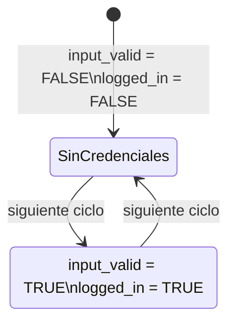

# Modelo de transición: inicio de sesión



La corrección se basa en mantener `logged_in = input_valid` en cada estado alcanzable.

Propiedades verificadas:

```smv
SPEC AG (!input_valid -> !logged_in)
SPEC AG (input_valid -> AF logged_in)
```


